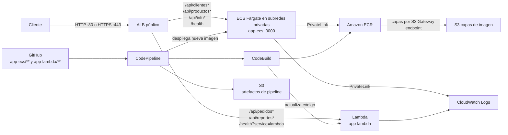

# Examen práctico DevOps — AWS CI/CD

Infraestructura como código y despliegue continuo de dos servicios Node.js en AWS. El proyecto usa Terraform para definir red, Application Load Balancer (ALB), Amazon ECS con Fargate, AWS Lambda, Amazon ECR, CodeBuild y CodePipeline.

> **Estado de la entrega:** este documento describe la configuración del repositorio. Completa los campos marcados como **por confirmar** con datos y capturas del despliegue real en AWS antes de entregar. No se deben presentar como exitosos recursos que todavía no hayan sido desplegados y comprobados.

## Arquitectura



El ALB es el punto de entrada público. Las reglas de ruta definidas en `terraform/alb.tf` distribuyen los contextos de catálogo a ECS y los contextos de pedidos/reportes a Lambda. El health check `/health` normal se dirige a ECS; Lambda tiene una regla distinguible en `/health?service=lambda`.

**Transporte:** HTTP en el puerto 80 está disponible por defecto. HTTPS se habilita al proporcionar un certificado ACM y su dominio DNS mediante las variables `alb_certificate_arn` y `alb_domain_name`. Al habilitarlo, el listener HTTP redirige a HTTPS y las reglas de aplicación se asocian al listener TLS.

## Componentes del repositorio

| Ruta | Propósito |
|---|---|
| `terraform/` | Recursos AWS, roles IAM, red, ALB, ECS, Lambda y pipelines. |
| `app-ecs/` | Servicio de clientes, productos e información desplegado en ECS/Fargate. |
| `app-lambda/` | Handler de pedidos y reportes desplegado en Lambda. |

Ambas aplicaciones están implementadas en Node.js y no declaran dependencias npm externas. Sus instrucciones específicas de ejecución local están en `app-ecs/README.md` y `app-lambda/README.md`.

Elegí GitHub porque se integra con AWS CodeConnections y permite proteger ramas y revisar cambios mediante Pull Requests. Mantengo ambas aplicaciones y Terraform en un monorepo para facilitar la revisión y coordinar cambios relacionados; los filtros por ruta hacen que cada servicio ejecute solo su pipeline.

### Puertos de red

| Puerto | Origen → destino | Uso |
|---|---|---|
| 80/TCP | Internet → ALB | HTTP; redirige a HTTPS cuando se configura un certificado ACM. |
| 443/TCP | Internet → ALB | HTTPS cuando se habilita un listener con certificado ACM. |
| 3000/TCP | Security Group del ALB → tareas ECS | Tráfico de aplicación y health checks. Las tareas no aceptan conexiones directas desde Internet. |

Lambda no expone un puerto de red: el ALB la invoca mediante su target group.

## Requisitos previos

- Cuenta AWS y perfil de AWS CLI con permisos suficientes para crear los recursos declarados por Terraform.
- Terraform `>= 1.10.0` y AWS CLI configurado.
- Git y acceso al repositorio de GitHub configurado en `terraform/variables.tf`.
- Node.js 24 o posterior para ejecutar las aplicaciones localmente; Docker para construir la imagen ECS localmente.
- Autorización de la conexión de GitHub en AWS CodeConnections/Developer Tools después de crearla con Terraform.

No guardes claves AWS, tokens ni otras credenciales en el repositorio. Usa perfiles, roles o mecanismos de identidad de AWS para autenticarte.

## Configuración inicial y despliegue

### Decisión sobre el estado de Terraform

El examen considera el estado remoto una mejora opcional. Para este proyecto elegí un bucket S3 dedicado con versionado, cifrado SSE-S3, bloqueo de acceso público, política que exige HTTPS y bloqueo de estado nativo (`use_lockfile`). Así se evita depender de un archivo local compartido manualmente y se conservan versiones recuperables. Terraform requiere versión 1.10 o posterior para el bloqueo S3.

El root de bootstrap crea el bucket con estado local porque el backend remoto todavía no existe en ese primer paso. La infraestructura principal usa `comercio/terraform.tfstate` y sus workspaces usan `workspaces/<workspace>/comercio/terraform.tfstate`. Para cumplir el examen, se migrará ese estado principal a S3; el estado pequeño del bootstrap se conserva local, protegido y excluido de Git. En una plataforma empresarial, el bucket de backend se provisionaría previamente en una cuenta central de herramientas, y también el estado del bootstrap residiría en almacenamiento remoto. En esta entrega ambos roots y ambientes comparten cuenta AWS y permisos base: es suficiente para el alcance del examen, pero no equivale a aislamiento empresarial. En producción separaría la cuenta de herramientas/estado de las cuentas de desarrollo, QA y producción, y limitaría el acceso IAM por ambiente y por clave S3.

El cifrado SSE-S3 y el control de acceso IAM son una decisión proporcional para el examen. Si la política corporativa exige control de claves y auditoría dedicada, usaría una CMK de KMS con permisos separados. El estado puede contener datos sensibles: conserva una copia de respaldo protegida durante la migración y nunca la subas al repositorio.

### Crear el bucket y migrar el estado

El bucket todavía no existe al inicio, por eso el root de bootstrap usa estado local. Mantén ese archivo fuera de Git, en almacenamiento cifrado y con copia de respaldo controlada:

La autenticación de este entorno usa IAM Identity Center. El perfil local `examen-devops` entrega credenciales temporales; no copies access keys, claves secretas ni el ARN temporal al código Terraform. En PowerShell, inicia sesión y confirma que la cuenta corresponde al proyecto antes de crear recursos:

```powershell
aws sso login --profile examen-devops
aws sts get-caller-identity --profile examen-devops
$env:AWS_PROFILE = "examen-devops"
$env:AWS_REGION = "us-west-2"
```

Continúa solo si la identidad muestra la cuenta esperada (`537275298020`). El proveedor AWS de Terraform usa las credenciales del perfil mediante la cadena estándar de AWS; no requiere declarar el perfil ni secretos en los archivos `.tf`.

```powershell
terraform -chdir=terraform/state-bootstrap init
terraform -chdir=terraform/state-bootstrap fmt -check -recursive
terraform -chdir=terraform/state-bootstrap validate
terraform -chdir=terraform/state-bootstrap plan -out=tfplan
terraform -chdir=terraform/state-bootstrap apply tfplan
$stateBucket = terraform -chdir=terraform/state-bootstrap output -raw state_bucket_name
terraform -chdir=terraform/state-bootstrap state list
```

Revisa el plan del bootstrap antes de aplicarlo: en la primera ejecución debe crear el bucket y sus controles, sin destruir recursos. El backend de la pila principal requiere Terraform 1.10 o posterior para usar el lockfile S3.

Antes de migrar la infraestructura principal, respalda fuera del repositorio los estados locales existentes, incluyendo los de `terraform.tfstate.d` si hay workspaces. Luego inicializa el backend S3; Terraform puede pedir confirmación para cada workspace local detectado. Confirma que todos los estados existentes deben copiarse. La clave base es `comercio/terraform.tfstate` para `default` (producción) y el prefijo de workspace es `workspaces/` para `desarrollo` y `qa`:

```powershell
terraform -chdir=terraform init -migrate-state "-backend-config=bucket=$stateBucket"
terraform -chdir=terraform workspace list
terraform -chdir=terraform workspace select default
terraform -chdir=terraform state list
```

Si había otros workspaces locales, selecciónalos y revisa también su `state list`. Conserva el respaldo protegido hasta confirmar que cada estado está en S3 y que `terraform plan` no propone destrucciones inesperadas. La migración copia el estado; no debe cambiar recursos AWS. Para un clon nuevo, no vuelvas a aplicar el root de bootstrap: el bucket ya existe y su estado local pertenece al responsable que lo creó. Obtén de esa persona el nombre del bucket e inicializa solo la pila principal con `terraform -chdir=terraform init "-backend-config=bucket=$stateBucket"`, sin `-migrate-state`.

Autentica AWS mediante un perfil o rol; no guardes credenciales en Terraform ni en los argumentos de backend. El rol de Terraform necesita listar el bucket y leer/escribir las claves de estado; para el bloqueo requiere leer, escribir y eliminar los objetos `.tflock`. No necesita `s3:DeleteObject` sobre el objeto de estado. Limita esos permisos al bucket de estado y, en producción, a las claves de los ambientes que administra.

Luego, desde la raíz del repositorio, revisa la cuenta y región, y ejecuta:

```powershell
terraform -chdir=terraform fmt -check -recursive
terraform -chdir=terraform validate
terraform -chdir=terraform plan -out=tfplan -var="ecs_desired_count=0"
terraform -chdir=terraform apply tfplan
```

Usa `ecs_desired_count=0` solo en un ambiente nuevo cuyo repositorio ECR todavía no tenga una imagen. El servicio ECS y los pipelines se crean, pero ECS no intenta descargar la etiqueta inicial `bootstrap`. Si el servicio ya existe, conserva el conteo actual y no lo reduzcas para resolver una imagen faltante.

La región predeterminada para los recursos AWS y el bootstrap del estado es `us-west-2` (Oregon). El backend S3 debe usar la región real del bucket de estado. Si ese bucket ya existe en otra región, conserva esa región en `terraform/providers.tf`; cambiarla sin mover el bucket impedirá inicializar el backend.

Para habilitar HTTPS, primero solicita o importa en ACM un certificado validado para tu dominio **en la misma región que el ALB**. Después aplica pasando el ARN y el dominio cubierto por el certificado:

```powershell
terraform -chdir=terraform plan -out=tfplan -var="alb_certificate_arn=arn:aws:acm:us-west-2:123456789012:certificate/ID" -var="alb_domain_name=api.ejemplo.com"
terraform -chdir=terraform apply tfplan
```

Sustituye ambos valores por los reales. El certificado debe estar emitido y válido; verifica que cubra exactamente el dominio usado. Después apunta el DNS de ese dominio al output `alb_dns_name` (Alias en Route 53 o el registro equivalente del proveedor DNS). No uses el DNS `amazonaws.com` del ALB como hostname HTTPS porque el certificado público no lo cubre. Sin esas variables, Terraform conserva el comportamiento HTTP.

Terraform crea una conexión de GitHub por ambiente, pero cada conexión requiere autorización en AWS. Después de cada `apply`, abre AWS Console → Developer Tools → Settings → Connections, localiza la conexión del ambiente (por ejemplo `comercio-desarrollo-github-conn`) y autorízala para el repositorio.

Cada workspace configura los dos pipelines para observar su propia rama: `default`/prod escucha `prod`, el workspace `desarrollo` escucha `desarrollo` y `qa` escucha `qa`.

- Cambios bajo `app-ecs/**` activan `app-ecs-pipeline`; CodeBuild construye y publica la imagen en ECR y CodePipeline despliega la nueva imagen en ECS.
- Cambios bajo `app-lambda/**` activan `app-lambda-pipeline`; CodeBuild empaqueta la función y una acción posterior actualiza Lambda.

Las imágenes ECS se publican con un tag único construido con versión, número de build y commit. ECR rechaza volver a usar un tag existente. El pipeline actualiza la task definition con el tag del artefacto; Terraform ignora ese atributo del servicio para no revertir la liberación en el siguiente `apply`.

### Primera imagen ECS en un ambiente nuevo

El examen pide al menos una tarea ECS saludable y un despliegue automático cuando cambia la aplicación. Para evitar que la tarea falle intentando descargar una imagen que todavía no existe, el primer `apply` crea el servicio con cero tareas. El pipeline publica una imagen identificable, actualiza la task definition y después se escala el servicio a una tarea. La etiqueta `bootstrap` queda como marcador sin ejecutar y el build no crea ni publica `latest`.

Después de aplicar la infraestructura con `ecs_desired_count=0`, confirma que el branch del ambiente exista y que su conexión de GitHub esté autorizada. La creación del pipeline podría haber iniciado ya una ejecución; revisa primero CodePipeline. Si no hay una ejecución exitosa que incluya `Deploy`, inicia una vez el pipeline ECS del workspace actual:

Ejecuta los siguientes comandos desde la raíz del repositorio. Si estabas trabajando dentro de `terraform/`, vuelve a la raíz con `cd ..`:

```powershell
$pipeline = terraform -chdir=terraform output -raw app_ecs_pipeline_name
aws codepipeline start-pipeline-execution --name $pipeline
```

Espera a que `Source`, `Build` y `Deploy` terminen correctamente. Después, escala el servicio al conteo normal (`1`) y revisa el plan antes de aplicar:

```powershell
terraform -chdir=terraform plan -out=tfplan
terraform -chdir=terraform apply tfplan
$cluster = terraform -chdir=terraform output -raw ecs_cluster_name
$service = terraform -chdir=terraform output -raw ecs_service_name
$targetGroup = terraform -chdir=terraform output -raw ecs_target_group_arn
aws ecs describe-services --cluster $cluster --services $service --query "services[0].{desired:desiredCount,running:runningCount}" --output table
aws elbv2 describe-target-health --target-group-arn $targetGroup --query "TargetHealthDescriptions[].TargetHealth.State" --output table
```

El resultado esperado es una tarea en ejecución y el target ECS en estado `healthy`. En ambientes existentes con `desired_count=1`, si la tarea está fallando porque falta la imagen, conserva el conteo y ejecuta el pipeline; no vuelvas a aplicar `ecs_desired_count=0`. Para los siguientes cambios bajo `app-ecs/**`, CodePipeline se ejecuta automáticamente. Si el filtro de archivos no inicia la primera ejecución al crear una rama, el inicio manual es solo el paso de bootstrap; AWS documenta ese caso para triggers con filtros por ruta.

Cuando ECS tenga una tarea saludable, la URL del ambiente activo se muestra en el output `alb_public_url` de Terraform.

> **Seguridad del estado:** el backend remoto está configurado en `terraform/providers.tf`; primero debes aplicar `terraform/state-bootstrap` y migrar el estado como se indica arriba. El estado puede contener valores sensibles: no lo guardes en Git ni compartas los archivos locales de `.terraform/`.

## Contextos y pruebas HTTP

Reemplaza `<ALB_URL>` por el valor real del output `alb_public_url` (sin barra final). Cuando HTTPS esté configurado y el DNS resuelto, el output usa `https://`; de otro modo usa `http://`. Las rutas responden solicitudes GET.

```bash
# Salud ECS
curl -i http://<ALB_URL>/health

# Servicio ECS
curl -i http://<ALB_URL>/api/clientes
curl -i http://<ALB_URL>/api/clientes/1
curl -i http://<ALB_URL>/api/productos
curl -i http://<ALB_URL>/api/productos/1
curl -i http://<ALB_URL>/api/info

# Servicio Lambda
curl -i 'http://<ALB_URL>/health?service=lambda'
curl -i http://<ALB_URL>/api/pedidos
curl -i http://<ALB_URL>/api/pedidos/1001
curl -i http://<ALB_URL>/api/reportes
curl -i http://<ALB_URL>/api/reportes/ventas-diarias
```

Los datos de clientes, productos, pedidos y reportes son datos de ejemplo definidos en el código de las aplicaciones; no representan una integración con una base de datos.

### Pruebas locales

ECS:

```powershell
cd app-ecs
npm start
```

En otra terminal: `curl http://localhost:3000/health`.

Lambda:

```powershell
cd app-lambda
npm run test:local
```

## IAM y controles de seguridad configurados

- Roles separados para ejecución de tareas ECS, tarea ECS, función Lambda, CodeBuild y CodePipeline.
- El rol de tarea ECS no tiene políticas adicionales en la configuración actual.
- Las tareas ECS aceptan el puerto 3000 desde el security group del ALB.
- Las tareas Fargate usan subredes privadas y no reciben IP pública; no hay ruta NAT ni salida general a Internet.
- Su salida HTTPS queda restringida a los endpoints de ECR/CloudWatch Logs y al prefix list de S3 requerido para descargar capas de imagen.
- Los endpoints de interfaz tienen DNS privado y aceptan HTTPS solo desde el security group de las tareas.
- La definición de tarea ECS configura filesystem raíz de solo lectura.
- Los logs de ECS, Lambda y CodeBuild se envían a CloudWatch Logs con retención definida.
- El bucket de artefactos bloquea acceso público y tiene versionado y cifrado del lado del servidor.
- ECR tiene escaneo al publicar y una política de ciclo de vida para limitar imágenes.
- ECR usa tags inmutables; CodePipeline publica tags versionados y administra la revisión activa del servicio ECS.
- CodeBuild usa roles distintos para build ECS, empaquetado Lambda y deploy Lambda. Solo el rol de deploy tiene permisos Lambda; los permisos de artefactos se limitan al bucket del ambiente.
- CodePipeline puede iniciar builds únicamente en los tres proyectos definidos y `iam:PassRole` exige que el rol se pase a `ecs-tasks.amazonaws.com`.
- Lambda permite invocación desde el target group configurado del ALB.

## Ambientes y estrategia de liberación

El flujo implementado corresponde a las ramas y Pull Requests pedidos en el examen. Cada ambiente se despliega en una pila Terraform independiente dentro de la misma cuenta AWS; los nombres de recursos llevan sufijo en `desarrollo` y `qa`. El workspace `default` conserva los nombres del despliegue existente y representa `prod`.

```text
feature/* o fix/* ── PR ──> desarrollo ── PR ──> qa ── PR aprobado ──> prod
                              │                    │                    │
                              └ auto deploy        └ auto deploy        └ auto deploy
```

El workflow `.github/workflows/branch-policy.yml` comprueba el origen y destino del PR al abrirse, actualizarse o cambiar de destino. Usa `pull_request_target` para leer su propia versión confiable del repositorio base; no descarga ni ejecuta código del PR y no recibe permisos de escritura. Es un check complementario: las Rulesets y las revisiones protegen las ramas. Los pipelines de cada workspace escuchan únicamente la rama de su ambiente y solo cuando cambian archivos de la aplicación correspondiente. `prod` exige aprobación de PR, Code Owner y checks antes del merge; después, CodePipeline despliega automáticamente.

Primero integra estos cambios a `main` y publícalos. Después, antes de inicializar los workspaces, crea y publica las ramas permanentes desde el repositorio Git conectado. Conserva el historial actual de `main` como punto inicial de producción:

```bash
git switch -c prod main
git push -u origin prod
git switch -c qa prod
git push -u origin qa
git switch -c desarrollo qa
git push -u origin desarrollo
```

Después configura las Rulesets de GitHub y crea ramas de trabajo desde `desarrollo`. Cambia la rama predeterminada del repositorio a `desarrollo`; conserva `main` protegida y sin escrituras durante la transición. El checkout de trabajo de esta evaluación no contiene `.git`, por lo que estos comandos deben ejecutarse en el clon Git del repositorio.

### Inicializar las pilas por ambiente

El workspace `default` se conserva como producción para no migrar el estado que ya pudiera existir. Selecciónalo y aplica Terraform para configurar los pipelines de la rama `prod`. Si es una instalación nueva y ECR no contiene imágenes, el primer plan debe usar `-var="ecs_desired_count=0"`; si ya existe el servicio, conserva el valor actual:

```powershell
cd terraform
terraform workspace select default
```

Si es una instalación nueva y el ECR está vacío, crea el servicio inicialmente sin tareas:

```powershell
terraform plan -out=tfplan -var="ecs_desired_count=0"
terraform apply tfplan
```

Si `default` ya tiene un servicio desplegado, conserva su conteo y ejecuta el plan sin esa variable:

```powershell
terraform plan -out=tfplan
terraform apply tfplan
```

Después crea las pilas aisladas de desarrollo y QA. Ejecuta `apply` en cada workspace; así se crean recursos, conexión GitHub y pipelines con nombres propios:

```powershell
terraform workspace new desarrollo
terraform plan -out=tfplan -var="ecs_desired_count=0"
terraform apply tfplan

terraform workspace new qa
terraform plan -out=tfplan -var="ecs_desired_count=0"
terraform apply tfplan
```

Después de crear cada workspace, autoriza su conexión y sigue “Primera imagen ECS en un ambiente nuevo” para ejecutar el pipeline y escalar a una tarea saludable. Cada workspace puede tener valores ACM/DNS propios mediante un archivo `.tfvars` distinto. Antes de desplegar, confirma que el workspace activo sea el previsto con `terraform workspace show`; los workspaces separan estado, no cuentas AWS.

Antes de crear los workspaces de equipo, completa el bootstrap y la migración al backend remoto descritos en “Configuración inicial y despliegue”. El estado de `default`, `desarrollo` y `qa` queda separado por sus claves S3; no compartas estados locales ni los subas al repositorio.

### Reglas empresariales para configurar en GitHub

GitHub no protege ramas solo por incluir un workflow en el repositorio. Primero reemplaza los marcadores del archivo `.github/CODEOWNERS.example` con equipos reales y guárdalo como `.github/CODEOWNERS`; incluye un Code Owner para `/.github/` para revisar cambios al workflow y a la política de ramas. Después, en **Settings → Rules → Rulesets**, crea reglas activas para `desarrollo`, `qa` y `prod`:

Publica primero el workflow en la rama predeterminada y confirma que el check aparezca en un PR de prueba; `pull_request_target` usa la definición de esa rama. Luego exige `validate-source-target` en las Rulesets.

- Bloquea pushes directos, force-push y borrado de ramas.
- Exige Pull Request y al menos una aprobación en `desarrollo` y `qa`.
- Exige dos aprobaciones para `prod`, incluyendo un Code Owner; el autor no aprueba su propio cambio. Tras el merge, el despliegue es automático.
- Descarta aprobaciones antiguas cuando cambie el PR, exige resolver conversaciones y exige el check `validate-source-target`.
- Limita quién puede modificar las reglas y quién puede aprobar cambios a producción.
- Usa squash merge para `feature/*`/`fix/*` hacia `desarrollo` y merge commit para promover `desarrollo`→`qa`→`prod`, conservando la trazabilidad entre ambientes.

El administrador del repositorio debe agregar los equipos reales como Code Owners y configurar esas reglas; el checkout actual no tiene un remoto Git disponible para aplicar settings de GitHub automáticamente.

## Evidencias de despliegue para la entrega

Completa esta sección solo después de verificar la cuenta AWS:

- **Repositorio Git:** por confirmar — agrega URL y confirma acceso para el evaluador.
- **URL pública del ALB:** por confirmar — pega el output real de `alb_public_url`.
- **Ejecuciones exitosas de CodePipeline:** por confirmar — agrega capturas de ambos pipelines con Source, Build y Deploy exitosos.
- **Servicio ECS:** por confirmar — captura el servicio con al menos una tarea saludable y logs recientes en CloudWatch.
- **Target groups del ALB:** por confirmar — captura targets ECS y Lambda en estado `healthy`.
- **Pruebas de rutas:** por confirmar — registra comandos y respuestas de `/health`, clientes, productos, pedidos y reportes.
- **Conexiones GitHub:** por confirmar — confirma que las conexiones de `default`/prod, `desarrollo` y `qa` están autorizadas.

Guarda las capturas en una carpeta de evidencias del repositorio y enlázalas aquí, cuidando no incluir credenciales, datos sensibles ni identificadores que no quieras compartir.

### Comprobación reproducible en AWS

Desde la raíz del repositorio, selecciona el workspace que vas a evidenciar (`default` para producción, `desarrollo` o `qa`) y ejecuta estos comandos en PowerShell. Requieren Terraform inicializado y AWS CLI autenticado en la cuenta y región correctas:

```powershell
terraform -chdir=terraform workspace show
$ecsPipeline = terraform -chdir=terraform output -raw app_ecs_pipeline_name
$lambdaPipeline = terraform -chdir=terraform output -raw app_lambda_pipeline_name
$cluster = terraform -chdir=terraform output -raw ecs_cluster_name
$service = terraform -chdir=terraform output -raw ecs_service_name
$ecsTargetGroup = terraform -chdir=terraform output -raw ecs_target_group_arn
$lambdaTargetGroup = terraform -chdir=terraform output -raw lambda_target_group_arn
$lambdaFunction = terraform -chdir=terraform output -raw lambda_function_name
$baseUrl = terraform -chdir=terraform output -raw alb_public_url

aws codepipeline get-pipeline-state --name $ecsPipeline
aws codepipeline get-pipeline-state --name $lambdaPipeline
aws ecs describe-services --cluster $cluster --services $service --query "services[0].{desired:desiredCount,running:runningCount,deployments:deployments[*].rolloutState}" --output table
aws lambda get-function-configuration --function-name $lambdaFunction --query "{State:State,LastUpdateStatus:LastUpdateStatus,Runtime:Runtime}" --output table
aws elbv2 describe-target-health --target-group-arn $ecsTargetGroup --output table
aws elbv2 describe-target-health --target-group-arn $lambdaTargetGroup --output table
curl.exe -i "$baseUrl/health"
curl.exe -i "$baseUrl/health?service=lambda"
curl.exe -i "$baseUrl/api/clientes"
curl.exe -i "$baseUrl/api/productos"
curl.exe -i "$baseUrl/api/pedidos"
curl.exe -i "$baseUrl/api/reportes"
```

En ambos pipelines, confirma que las etapas `Source`, `Build` y `Deploy` terminaron correctamente. Para ECS, `running` debe ser igual o mayor que `desired` y el target debe estar `healthy`; revisa Lambda en estado `Active` con `LastUpdateStatus` `Successful`. Guarda capturas fechadas de esos resultados, la URL del ALB y las respuestas HTTP. Si el pipeline ECS no inició al crear la rama, verifica primero que la conexión GitHub esté autorizada y que la rama y los archivos de la aplicación coincidan con el filtro; después inicia solo el pipeline del workspace correspondiente con `aws codepipeline start-pipeline-execution --name $ecsPipeline` y vuelve a comprobar el estado. AWS documenta que una rama recién creada puede no disparar un pipeline con filtros de rama/ruta; el inicio manual es una recuperación puntual, no sustituye el trigger automático para los siguientes commits.

## Problemas conocidos y seguimiento

- **Artefacto de despliegue de Lambda:** la acción de despliegue recibe `source_output` y `build_output`, mientras que `buildspec-deploy.yml` usa `function.zip` relativo al directorio de trabajo. Verifica que el buildspec tome el ZIP desde el directorio del artefacto secundario (`CODEBUILD_SRC_DIR_build_output/function.zip`, si el identificador del artefacto es `build_output`) y confirma la ruta en el log de CodeBuild.
- **HTTPS requiere configuración:** el listener se crea cuando se pasan `alb_certificate_arn` y `alb_domain_name`. Sin un certificado ACM emitido y DNS apuntando al ALB, el output permanece en HTTP y no se debe anunciar HTTPS.
- **Bootstrap remoto pendiente de ejecutar:** el código crea un bucket de estado dedicado y el root principal ya declara el backend S3; aún se debe aplicar el bootstrap y migrar los estados locales.
- **Protección GitHub pendiente de activar:** el workflow verifica el origen/destino de los PR, pero las Rulesets, equipos Code Owner y aprobaciones deben configurarse en el repositorio remoto.
- **Costos de red privada:** los endpoints de interfaz de ECR y CloudWatch Logs tienen costo por AZ y tráfico. El diseño evita NAT y salida general a Internet para las tareas; revisa costos y métricas antes de desplegar en producción.
- **Bootstrap ECS:** una pila nueva crea primero el repositorio ECR vacío; espera la primera ejecución exitosa del pipeline para que ECS reciba la primera imagen con tag inmutable.
- **Cambio de roles CodeBuild:** antes de aplicar la migración desde el rol compartido, confirma que no haya builds activos. Terraform cambia cada proyecto a su rol específico y luego elimina la política/rol compartidos.

Los hallazgos anteriores son elementos de configuración por revisar; no se consideran resueltos hasta cambiar la infraestructura, aplicar el cambio y comprobar el resultado.

## Limpieza de recursos

No ejecutes `terraform destroy` durante la evaluación. Conserva los recursos y evidencias hasta que el evaluador indique que puedes eliminarlos.
